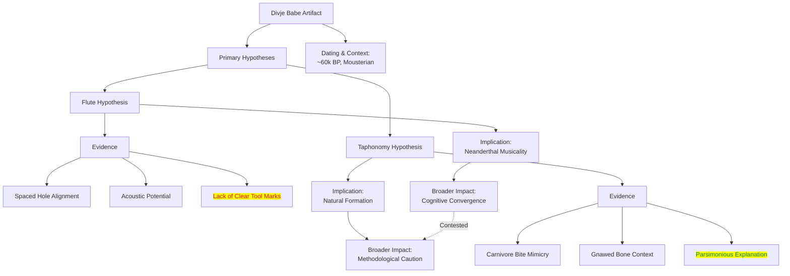

# The Divje Babe Artifact

### 1. Reformulation and Theoretical Foundations

The Divje Babe artifact represents a critical nexus in the study of <mark class="hltr-blue">human evolution</mark> and the origins of <mark class="hltr-blue">musical behavior</mark>. Its analysis forces a confrontation between <mark class="hltr-green">archaeological interpretation and taphonomic processes, challenging our capacity to distinguish cultural objects from natural phenomena</mark>. The theoretical framework for understanding this object is rooted in the <mark class="hltr-blue">archaeology of music</mark>, which seeks material evidence for sound-producing activities in prehistory (Morley 2013). The debate surrounding the artifact engages with fundamental questions about <mark class="hltr-green">Neanderthal cognitive capabilities and their potential for symbolic thought and aesthetic expression</mark>, a central controversy in paleoanthropology (d'Errico et al. 1998). The interpretation hinges on applying <mark class="hltr-orange">middle-range theory</mark>, using modern experimental analogues to infer past behaviors from static material remains.

### 2. Taphonomy versus Technicity

The core of the Divje Babe controversy lies in differentiating anthropogenic modification from taphonomic alteration. The artifact is a juvenile cave bear (*Ursus spelaeus*) femur, approximately 11.6 cm long, featuring two complete and two partial holes aligned along its length. Proponents of the flute hypothesis, such as Turk et al. (1995), argue that the <mark class="hltr-orange">spacing and morphology of the holes are consistent with finger holes designed for a diatonic scale</mark>. Replicative experiments have demonstrated that similar objects can produce a range of tones when blown correctly.

Conversely, skeptics propose that the holes resulted from the <mark class="hltr-orange">post-depositional activity of carnivores</mark>, likely a spotted hyena (*Crocuta crocuta*) puncturing the bone to access the marrow (d'Errico et al. 1998). This taphonomic explanation posits that the punctures are bite marks, their alignment a coincidental byproduct of jaw morphology and bone structure. The absence of clear, unambiguous tool marks around the holes and the presence of other carnivore-gnawed bones at the site lend significant weight to this alternative interpretation. This positions the object as a <mark class="hltr-red">litmus test for methodological rigor in identifying early musical instruments</mark>.

### 3. Research Questions

1.  What constitutes definitive evidence for intentional musical instrument fabrication in the archaeological record, and can such criteria be reliably distinguished from taphonomic mimics?
2.  How can interdisciplinary methods—combining archaeology, taphonomy, acoustics, and materials science—be refined to resolve ambiguous artifacts like the Divje Babe bone?
3.  If confirmed as an instrument, what would the existence of a Neanderthal flute imply for models of cultural transmission and cognitive convergence between *Homo sapiens* and *Homo neanderthalensis*?

### 4. References

```bibtex
@article{turk1995,
  author = {Turk, Ivan and Dirjec, Janez and Kavur, Boris},
  title = {The oldest musical instrument in Europe discovered in Slovenia?},
  journal = {Razprave IV. Razreda SAZU},
  volume = {36},
  pages = {287--293},
  year = {1995}
}
@article{derrico1998,
  author = {d'Errico, Francesco and Villa, Paola and Pinto Llona, Ana C. and Ruiz Idarraga, Rosa},
  title = {A Middle Palaeolithic origin of music? Using cave-bear bone accumulations to assess the Divje Babe I bone ‘flute’},
  journal = {Antiquity},
  volume = {72},
  number = {275},
  pages = {65--79},
  year = {1998}
}
@book{morley2013,
  author = {Morley, Iain},
  title = {The Prehistory of Music: Human Evolution, Archaeology, and the Origins of Musicality},
  year = {2013},
  publisher = {Oxford University Press}
}
@article{lawson2002,
  author = {Lawson, Graeme and Cross, Ian},
  title = {The Sounds of the Divje Babe Flute: An Analysis and Interpretation},
  journal = {Archaeologia Slovenica},
  volume = {2},
  pages = {243--252},
  year = {2002}
}
```

### Context and Background

The artifact was uncovered in 1995 at the Divje Babe I cave site in northwestern Slovenia, within a stratigraphic layer dated to approximately <mark class="hltr-yellow">60,000 years BP</mark>, firmly associating it with a Neanderthal occupation (Mousterian industry). This period predates the confirmed presence of *Homo sapiens* in Europe, making any claim of Neanderthal musicality profoundly significant. The discovery occurred amidst a growing reassessment of Neanderthals, moving away from viewing them as brutish and towards recognizing their potential for complex behaviors.

### Objective

The primary objective in studying the Divje Babe artifact is to determine its origin: whether it is an intentionally manufactured wind instrument or a naturally modified bone. Resolving this directly addresses broader questions about <mark class="hltr-green">the cognitive and cultural capacities of Neanderthals, specifically their ability for abstract thought and non-utilitarian behavior</mark>.

### Methodology

Research has employed a multi-pronged methodological approach:
1.  **Morphometric Analysis:** Precise measurement of the hole spacing, diameter, and cross-sectional shape.
2.  **Comparative Taphonomy:** Examining modern bone assemblages modified by known carnivores to identify diagnostic patterns of puncture marks.
3.  **Experimental Replication:** Creating replicas of the object from bear bones to test both the carnivore-puncture hypothesis and its acoustic properties as a flute.
4.  **Microscopy:** Using scanning electron microscopy (SEM) to inspect the holes for microscopic striations or wear patterns indicative of stone tool working or use.

### Key Findings

-   The holes are located on the posterior side of the diaphysis, an atypical but not impossible position for a flute.
-   Experimental carnivore bites can produce holes similar in morphology and alignment.
-   Acoustic analyses show that a replica can produce distinct tones if one end is beveled and it is blown transversely.
-   Microscopic evidence for tool work remains ambiguous and is contested among specialists.

### Implications and Future Work

If authenticated, the flute would provide compelling evidence for independent musical invention by Neanderthals. Future work should focus on high-resolution micro-CT scanning to create detailed internal models of the holes, searching for manufacturing traces invisible to surface inspection. Applying new geometric morphometric techniques to compare its hole patterns against large databases of confirmed carnivore punctures and anthropogenic perforations could provide a more statistically robust classification.

### Critical Evaluation

The principal weakness of the flute hypothesis is the <mark class="hltr-red">lack of unequivocal tool marks</mark>, which are present on later, undisputed Paleolithic flutes. The taphonomic counter-hypothesis provides a robust null model that is difficult to falsify completely. The debate is often polarized, with interpretations sometimes reflecting prior assumptions about Neanderthal capabilities rather than being strictly driven by the empirical data.

### Visual Map



### Spaced Repetition Prompts

-   What are the two primary competing hypotheses for the origin of the holes in the Divje Babe artifact? ::: The flute hypothesis (anthropogenic) and the taphonomy hypothesis (carnivore activity).
-   Which methodological approach is crucial for distinguishing between anthropogenic and natural modifications on archaeological bones? ::: Comparative taphonomy, which involves comparing the artifact's features to modern assemblages modified by known agents like carnivores.
-   What is the central implication for Neanderthal studies if the Divje Babe artifact is confirmed as a flute? ::: It would provide strong evidence for independent complex, potentially symbolic behavior like music-making in Neanderthals, indicating higher cognitive capabilities.
-   What is a major weakness or point of criticism against interpreting the Divje Babe bone as a musical instrument? ::: The lack of unambiguous stone tool marks on or around the holes, which are typically found on later, undisputed Paleolithic flutes.
-   In which country and archaeological context was the Divje Babe artifact discovered? ::: It was found in the Divje Babe I cave site in Slovenia, within a Mousterian layer associated with Neanderthals.